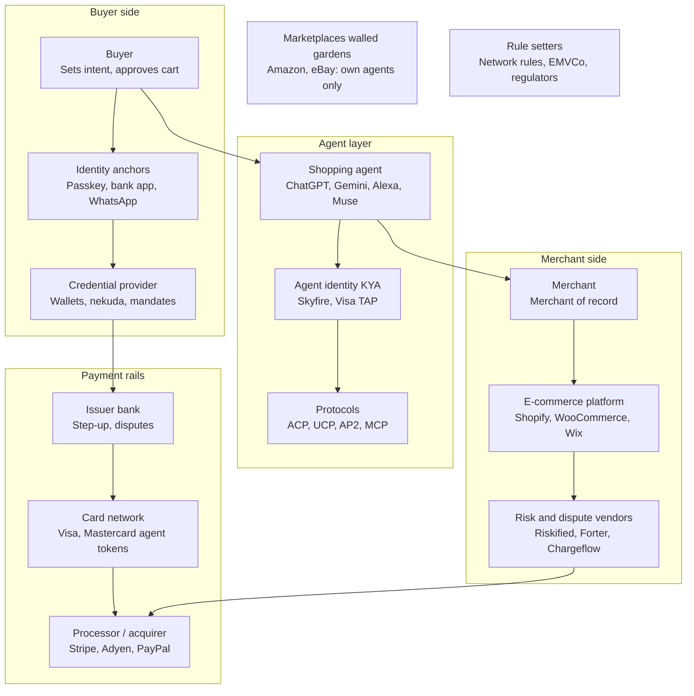

# Agentic Commerce: Product Directions Evaluation

Directions discussed for a product in the Human → Agent → Merchant flow, evaluated as a greenfield entrant able to start small and target a region or vertical first. 1 November 2026.

## The lens

**What being new buys:** designing for agent orders natively rather than bolting them onto a fraud model built on human behavioral signals; taking positions incumbents can't (openly agent- and protocol-agnostic, a region the big players ignore, accepting liability a public company's risk committee won't); and serving merchants the enterprise vendors can't profitably reach.

**What it doesn't buy:** distribution, data, trust or capital. Any direction that depends on one of those early is weaker for a newcomer. The test for each direction: does it win on design freedom and focus, or does it need scale to work?

## Directions

| Direction | What it is | Does being greenfield help? | Does narrow entry (region / vertical) work? | Who already does it | Verdict |
|---|---|---|---|---|---|
| 1. Protocol abstraction + catalog pipe | One integration exposing a merchant's catalog and checkout across ACP / UCP / AP2, KYA handled | No. Platforms and Stripe ship it for 80%+ of merchants by store count; being new means being late | Only in the uncovered slice: custom carts, Magento, regional platforms, non-US stores | Shopify (native), Stripe Agentic Commerce Suite (Woo, Wix, BigCommerce, Squarespace), Adyen Agentic, Firmly | **Drop as a product.** Build only what the wedge needs |
| 2. Buyer-side spending controls / agent-agnostic wallet | Mandates, caps and cart guarantees that travel with the buyer regardless of agent | No. Only achievable at the payment credential, which card networks and funded startups own; needs issuing and scale | No. A wallet in one region is still a wallet nobody has | Visa Intelligent Commerce, Mastercard Agent Pay, nekuda, Basis Theory, Skyfire, Reap | **Partner, don't build.** Consume mandates (AP2, Verifiable Intent) |
| 3. Merchant risk layer | Agent detection, HP/NHP classification, merchant rules, risk-based confirmation (WhatsApp-delivered, passkey or bank step-up), evidence vault | **Yes, strongly.** Native design for agent orders; small merchants; confirmation flows tuned to a region's channels | **Yes.** Loss per mistake and the strong confirmation channel both vary by vertical and region | Riskified / Forter (enterprise, fraud-centric); nobody for small merchants | **Core of the wedge** |
| 4. Human-anchored identity / assurance levels | Enrollment during human-scored sessions; tiered anchors (OTP = notify only; device-bound passkey; issuer / bank step-up; liveness) | Yes. Be the identity-linking server for merchants who have none; tune anchors to local rails | Yes. Which anchor is strong is regional (bank apps, national eID, WhatsApp penetration) | Platforms for their own merchants (Shopify via UCP identity linking); none for the long tail | **Infrastructure for both risk and retention; build once** |
| 5. Retention layer | Identity link, loyalty entitlements and member pricing through agents, merchant-branded confirmation channel, post-purchase ownership | Partly. Shopify covers its own merchants; you win where the platform's identity story is thin or absent | Yes. Loyalty mechanics are vertical-specific | Shopify (own merchants); CRM / loyalty vendors not yet agent-aware | **Second product on the same identity link; likely the easier sale** |
| 6. Agent-level merchant reputation | A merchant's reliability as seen by agents: order accuracy, substitution rate, dispute rate, returns, confirmation response | Yes. Nobody computes it; needs no legacy and no permission | Yes. A score within one vertical is already useful | Nobody | **Cheap to start, compounds, connects risk to retention** |
| 7. Buyer / seller protection (guarantee) | Underwriting agent orders: the party holding the buyer's mandate and the merchant's order evidence insures the transaction | Mixed. Incumbents won't do it (why the gap exists), but it needs outcome data and capital a newcomer lacks | Yes, and only narrow: underwriting one vertical in one region is feasible; everything isn't | Nobody for agent orders; Paddle-style merchant-of-record providers absorb chargebacks for digital goods; Signifyd's Complete Chargeback Protection covers non-fraud codes on orders it approves | **Destination, not entry.** Earn it with data from 3–6 |
| 8. Catalog quality / GEO | Structured, verifiable product data so agents include and prefer the merchant | No. Crowded, and not where small merchants' losses are | Weakly | Paz.ai, Salsify, Syndigo, Productsup, platform feeds | **Feature, not product** |

Directions 3–6 are feasible for a greenfield entrant and form one cluster (risk layer + identity, with reputation as the compounding asset). Direction 7 is the long-term destination the cluster earns. Directions 1, 2 and 8: drop, partner, or treat as a feature.

## Detailed breakdown of the feasible directions

### 3. Merchant risk layer (core of the wedge)

**What it does.** For every order, answer three questions and act on them: did an agent place it; did a human approve this exact cart (HP) or only a standing instruction (NHP); and given the merchant's rules, should it ship, be confirmed with the human first, be held, or be refused.

**Components**

- **Detection.** Protocol-declared agent orders (ACP, UCP, AP2 carry it explicitly) plus browser-driven agents. Output is a per-order classification with a confidence score, not a boolean.
- **HP/NHP classification.** Read the signed Cart Mandate (AP2), Verifiable Intent artifact (Mastercard), or the platform's checkout confirmation flag. Absent any of those, treat as NHP.
- **Rules engine.** Merchant-authored policies over order value, category, customer history, agent identity, HP/NHP, and anomaly versus the customer's past orders. Actions: allow, confirm (with an assurance level, see direction 4), hold for review, decline.
- **Confirmation.** Delivered over WhatsApp, push or email; the approval itself is a passkey or bank step-up link, never the message reply. Response latency and device matching feed back into risk.
- **Evidence vault.** Per order: the mandate, the confirmation record with its assurance level, the rule that fired, timestamps, agent identity. Exportable as a dispute package in the processor's format.

**Who pays and how.** The merchant. A per-agent-order fee (a few cents plus roughly 0.3–0.8% of agent-order value, well under the 1–3% of revenue the loss model attributes to mistakes) or a flat monthly tier by order volume. Confirmation messages at cost plus margin.

**Dependencies.** A platform app surface (Shopify app, WooCommerce plugin) for order and customer data; a WhatsApp Business API provider; WebAuthn relying-party infrastructure; a processor relationship to submit evidence.

**Build order.** Detection and classification first, with a read-only dashboard: that alone produces data nobody has and is sellable as "see your agent orders." Rules and confirmation second. Evidence export third.

**Main risks.** Agent-order volume in the target region too low to show value in year one; platforms add a basic "confirm agent orders" toggle; confirmation friction annoys NHP users (mitigation: default rules that confirm rarely and only on anomaly).

**Validation.** Ten travel or digital merchants: do they see agent orders today, would they turn on a rule, and would they pay before the first dispute? Plus a test with a dispute firm on whether the evidence package changes a representment outcome.

### 4. Human-anchored identity and assurance levels

**What it does.** Guarantees that a confirmation came from the human, not from an agent holding the human's phone and inbox, by anchoring identity at an enrollment moment the agent wasn't part of, and by grading each confirmation with an assurance level.

**Components**

- **Enrollment gate.** During sessions scored as human (detection running in real time), offer passkey registration and device binding; store the anchor with the session score attached. Anchors registered during agent-scored sessions are recorded but not trusted.
- **Assurance ladder.** Level 0: OTP or WhatsApp reply (notification only). Level 1: device-bound passkey with user verification, attestation checked where available. Level 2: issuer or wallet step-up (3DS, bank app, Mastercard Verifiable Intent). Level 3: liveness biometric with injection detection, or national eID. The rules engine picks the level; the identity layer executes it.
- **Signals.** Confirmation device versus agent infrastructure (IP, fingerprint), response latency, prior human-session device history.
- **Profile endpoint.** UCP-style identity linking (OAuth 2.0) so the merchant's customer record can be resolved from an agent session with consent; direction 5 runs on it.

**Who pays.** Nobody directly; it is infrastructure priced inside direction 3 (confirmation tiers) and direction 5.

**Dependencies.** WebAuthn infrastructure on a domain you or the merchant control; issuer step-up access through the merchant's processor; for first-time customers there is no anchor: fall back to level 2 or accept the gap.

**Build order.** Passkey enrollment and level 1 first (self-contained). Level 2 through the processor second. Level 3 only on demand from high-value merchants.

**Main risks.** Apple passkeys give no attestation, so software authenticators can't always be excluded; cold-start customers have no anchor; privacy consent for linking customer records across an agent session (GDPR and local privacy law).

**Validation.** Measure what share of a merchant's customers complete passkey enrollment when offered during a normal human checkout. Under about 20%, the ladder leans on level 2 and the processor dependency becomes critical.

### 5. Retention layer

**What it does.** Keeps the merchant's relationship with the customer alive when an agent sits in between: the agent recognizes the customer at the merchant, the merchant's terms for that customer reach the agent, and the merchant keeps a direct, consented channel.

**Components**

- **Identity linking server.** The OAuth flow and profile endpoint from direction 4, exposed to agents under UCP (matched on ACP's buyer email/phone where that is all you get).
- **Entitlements.** Loyalty tier, member pricing, customer-only products, returned through the catalog and checkout endpoints the platform already exposes. Member pricing built as an opt-in program with uniform tier pricing, never per-person computed prices (New York's disclosure act, the One Fair Price Act, EU rules).
- **Branded confirmation and post-purchase channel.** Confirmation, tracking, returns and the next offer go out under the merchant's name on the channel the customer consented to.
- **Program builder.** Many small merchants have no loyalty program; the product has to create one, not just connect one.

**Who pays and how.** The merchant, on a retention story: recovered repeat orders from agent-mediated customers. Monthly tier, or a share of attributed repeat revenue.

**Dependencies.** Direction 4 in place; platform APIs for customer records and discounts; agent platforms' terms permitting post-order merchant contact (verify per platform).

**Build order.** After direction 3 has customers: same merchants, same link. Identity linking and member pricing first; program builder later.

**Main risks.** Shopify already covers its own merchants' identity linking, so the market is WooCommerce, Wix, custom and regional platforms; agent platforms may restrict direct merchant messaging; the price-personalization legal patchwork is moving fast.

**Validation.** Ask merchants whether they'd give agent-mediated customers a better price than the open market to win the comparison. If not, the retention product has no lever.

### 6. Agent-level merchant reputation

**What it does.** Computes how reliable a merchant is as agents experience it: order accuracy, substitution and stock-out rate, time to confirm, dispute rate, return rate on agent orders, HP/NHP mix. First for the merchant's own eyes, then as a signal agents can use.

**Components**

- **Metric pipeline** over the data directions 3–5 already produce; no new instrumentation.
- **Benchmarks** within a vertical and region: fifty travel merchants in one market already make a benchmark.
- **Publication.** A verifiable merchant attestation agents or agent platforms can read, delivered alongside KYA or Visa's Trusted Agent exchange.

**Who pays.** Initially nobody; it is the compounding asset and the reason an agent platform would route to your merchants. Later: merchants pay to improve and display it; agent platforms pay for access.

**Build order.** Dashboard version as soon as direction 3 has a few months of data. External publication only once an agent platform wants it.

**Main risks.** Small-sample noise early; gaming by merchants; agent platforms building their own scores from their own data, so yours must cover merchants they can't see across.

**Validation.** Whether one agent platform or mandate provider agrees in principle to consume a merchant attestation.

### 7. Buyer / seller protection (destination)

**What it does.** Guarantees agent orders: the buyer is refunded for an agent mistake, the merchant isn't left with the loss, and the gap is underwritten from outcome data.

**Components.** Outcome dataset by vertical, region and assurance level (from 3–6); per-order pricing model (the loss model with real rates); claims flow; an insurance or acquirer partner to carry the risk initially; a legal form (merchant of record for guaranteed orders, or an insurance-backed warranty).

**Who pays.** Merchants, as a per-order premium, likely 0.5–1.5% of agent-order value depending on vertical; possibly agent platforms, who want a "covered" badge.

**Dependencies.** Everything above, plus capital or a risk partner, plus licensing. Paddle-style merchant-of-record providers already do a version of this for digital goods: both a competitor and a template.

**When.** Not before a few hundred thousand agent orders with known outcomes, and not before a partner is willing to carry the first book.

**Validation.** Two conversations: one acquirer and one insurer, asking what data they'd need to back a guarantee on one vertical in one region.

## Risk register: what an agent in the middle adds, and which direction addresses it

Scores 1–5 (likelihood × impact): short term = next 12–18 months with today's missing standards but low agent volume; long term = 3–5 years once rules settle but agent share is material. Scores are judgments, not sourced figures.

### A. Financial and liability

| # | Risk | Short | Long | What moves it | Addressed by | How |
|---|---|---|---|---|---|---|
| A1 | Liability lands on the merchant by default for disputed agent orders | 5 | 2 | Network reason codes and liability shifts; mandates accepted as authorization proof | 3, 7 | 3: confirmation turns NHP orders into HP with a signed cart approval; evidence vault packages it for representment. 7: guarantee absorbs the residual loss. |
| A2 | Loss of dispute evidence (device, IP, session describe the agent) | 5 | 2 | Mandates and intent artifacts accepted as evidence | 3, 4 | 3: stores mandate, rule fired, timestamps, agent identity. 4: confirmation carries an assurance level (which anchor, which device), replacing the missing session evidence. |
| A3 | New dispute category: "my agent did it" / "it misread my instruction" | 3 | 3 | Becomes a defined category with rules; also a known loophole | 3, 4 | Signed cart approval through a human-anchored passkey or bank step-up contradicts the claim; absent one, the order was flagged NHP and held or confirmed. |
| A4 | Agent disputes push the merchant over network monitoring thresholds | 3 | 3 | Volume-gated; networks may segment agent disputes | 3, 7 | 3: prevents disputes before they exist (cancel-before-ship on anomalies, confirmation on high value). 7: a guarantee refunds the buyer directly so fewer cases reach the bank. |
| A5 | Platform take rates, fees not reversed on chargebacks, future placement fees | 3 | 4 | Fees persist; placement becomes pay-to-play | 5 (partial) | Retention moves repeat orders to the merchant's direct channel, reducing the share of revenue paying platform fees. The fee itself is not addressed. |

### B. Operational and accuracy

| # | Risk | Short | Long | What moves it | Addressed by | How |
|---|---|---|---|---|---|---|
| B1 | Agent order errors (wrong variant, quantity, seller) producing returns and disputes | 4 | 2 | Model accuracy; HP confirmation becoming standard | 3, 5, 6 | 3: anomaly rules confirm before shipping. 5: identity linking pre-fills a correct profile, removing cold-start errors. 6: error patterns per agent fed back to the merchant. |
| B2 | Price and stock mismatches between feed and reality | 4 | 3 | Feed standards mature; freshness stays the merchant's job | 6, 3 (partial) | 6: reputation metrics surface stale-feed failures per merchant. 3: mismatch detected at checkout triggers re-confirmation instead of a silent change. Feed quality itself is out of scope. |
| B3 | Post-approval changes: substitutions, split shipments, price changes | 3 | 3 | Protocols adding re-confirmation for changed carts | 3 | A changed-cart rule re-confirms with the human and records the second approval. |
| B4 | False declines: the merchant's own fraud stack blocks legitimate agents | 4 | 1 | Trusted Agent Protocol and KYA adoption | 3 | Detection classifies registered agents and passes an allow signal to the merchant's fraud tooling. |
| B5 | Agent-driven traffic spikes indistinguishable from attack traffic | 3 | 2 | Agent identification standards; CDN handling | 3 (partial) | Detection distinguishes registered agents from unknown automation; load handling itself is out of scope. |

### C. Fraud and security

| # | Risk | Short | Long | What moves it | Addressed by | How |
|---|---|---|---|---|---|---|
| C1 | Impersonation: bots posing as agents; legitimate agents hijacked via prompt injection | 4 | 3 | KYA and signed requests; injection is an arms race | 3 (partial) | Rules require verified agent identity (KYA / TAP) for sensitive actions; injection in product data is out of scope. |
| C2 | Credential and token abuse: scoped agent tokens leaked, mandates replayed | 3 | 2 | Network token controls mature | 3 (partial), partner | Rules check token scope and mandate against the cart (merchant, cap, expiry); the credential layer itself is the partner's. |
| C3 | Policy abuse at scale: returns, promos, loyalty exploited by agents | 3 | 4 | Automation makes abuse cheaper; arms race | 3, 4, 6 | 3: velocity and abuse rules on agent orders. 4: abuse tied to anchored identities, not anonymous sessions. 6: cross-merchant velocity within the network. |
| C4 | Identity spoofing of the human: agents answering OTPs and confirmations with the user's own channels | 4 | 3 | Device-bound passkeys and issuer step-up | 4 | Core of direction 4: anchors enrolled during human-scored sessions; assurance ladder treats OTP and chat replies as notification only. |

### D. Commercial and strategic

| # | Risk | Short | Long | What moves it | Addressed by | How |
|---|---|---|---|---|---|---|
| D1 | Disintermediation: loss of the customer relationship and first-party data | 2 | 5 | Structural; identity linking mitigates | 5, 4 | 5: identity linking resolves the customer at the merchant, keeps entitlements and a consented direct channel. 4: provides the link and consent record. |
| D2 | Commoditization and price pressure as agents compare on verifiable facts | 2 | 5 | Grows with agent share | 5 (partial) | Member terms and entitlements give the merchant's own customers a price the open market doesn't see, so the agent's re-evaluation keeps choosing them. |
| D3 | Ranking opacity and platform dependence: delisting, demotion, pay-to-play | 3 | 5 | Concentration; ranking regulation | 6, 5 (partial) | 6: a verifiable reliability attestation gives agents a reason to route to the merchant. 5: direct channel reduces dependence. Ranking itself is the platform's. |
| D4 | Protocol fragmentation and integration churn | 4 | 2 | Consolidation; abstraction layers | Not addressed | Handled by platforms and processors; the risk layer must consume every protocol but doesn't solve the merchant's integration burden. |
| D5 | Walled gardens cutting off reach for marketplace sellers | 3 | 3 | Court outcomes; marketplace strategy | Not addressed | Outside any merchant-side product's control. |
| D6 | Agent-level reputation damage, including for errors the agent caused | 3 | 5 | Grows as agents keep history | 6, 3 | 6: the merchant sees and can contest its agent-side record, and fixes causes. 3: fewer errors reach agents in the first place. |

### E. Legal and compliance

| # | Risk | Short | Long | What moves it | Addressed by | How |
|---|---|---|---|---|---|---|
| E1 | Consumer-protection ambiguity: who is the seller, who misrepresented, cooling-off rights | 4 | 3 | Regulators and courts assign responsibility | 3, 4 (partial) | Evidence of exactly what the human approved, at what assurance level, bounds the merchant's exposure to the agent's claims. |
| E2 | Personalized-pricing law when offering member terms through agents | 3 | 4 | Regulation expanding | 5 | Program design: opt-in loyalty with uniform tier pricing, never per-person computed prices; disclosure built into the entitlement flow. |
| E3 | Privacy and consent for identity linking and data shared with agent platforms | 3 | 3 | GDPR enforcement; local privacy law | 4 (partial) | Consent captured and recorded at identity linking; data minimization in what is returned to agents. |
| E4 | SCA / 3DS rules applied to transactions designed for a human present | 4 | 2 | EMVCo and PSD3-era agent flows | 4 (partial) | Issuer step-up used as an assurance level makes the confirmation itself SCA-compliant where the issuer supports it. |

### Coverage by direction

| Direction | Solves | Mitigates | What it leaves alone |
|---|---|---|---|
| 3. Merchant risk layer | A1, A2, A3, A4, B1, B3, B4 | B2, B5, C1, C2, C3, D6, E1 | Platform fees (A5), ranking (D3), fragmentation (D4), walled gardens (D5), feed quality |
| 4. Human-anchored identity | C4, A2 (assurance grading) | A3, C3, D1, E1, E3, E4 | Cold-start customers with no anchor; attestation gaps on some platforms |
| 5. Retention layer | D1, E2 (by program design) | A5, B1, D2, D3 | Ranking itself; merchants on platforms that already provide identity linking |
| 6. Agent-level reputation | D6, B2 (visibility) | B1, C3, D3 | Agent platforms' own scores; small-sample noise early |
| 7. Guarantee | A1, A4 (transfers them) | — | Everything upstream; depends on 3–6 for data and on a risk partner |
| Not addressed by any direction | — | — | A5 fees, D3 ranking, D4 fragmentation, D5 walled gardens, B5 load, C1 injection: platform, court or infrastructure problems, not merchant-side product problems |

### Reading the pattern

- **Risks that fall as standards arrive** (A1, A2, B4, D4, E4, C2, B5) are high today only because the rails are unfinished. Direction 3 sells on them now, but their market shrinks; its long-term value is the data and identity it accumulates.
- **Risks that rise with agent share** (D1, D2, D3, D6, C3, A5, E2) are where the durable product is. Directions 5 and 6 address D1, D2 and D6 directly.
- **Risks that persist as an arms race** (A3, B2, B3, C1, C4, E1, E3) need continuous tooling; these are the recurring-revenue risks, split between 3 and 4.
- The first pitch (A1/A2: "you're liable and have no evidence") has the shortest shelf life. It is the right door now; the contract should be for the second and third groups.

## Appendix A. Actors in agentic commerce

Three columns: the buyer's side, the agent layer and the merchant's side. Each has the actor itself, the identity that vouches for it, and the thing that carries its transactions. Payment rails are shared; marketplaces and rule setters set the terms without taking part.

Where disputes land: between the credential provider on the buyer side and the risk vendors on the merchant side, with the card network in between and no actor responsible for the agent's mistake. The proposed product sits on the merchant side of that seam, between the e-commerce platform and the risk vendors, reaching back to the buyer's identity anchors for confirmation.

## Appendix B. Example flow: an agent books a hotel

Dana asks her assistant to book two nights at a boutique hotel in the Galilee for under 1,200 ILS. Each step names who acts and what breaks if they don't.

### 1. Intent
*Who acts: Buyer · Shopping agent · Credential provider*

Dana tells the agent what she wants. The agent writes it down as a signed intent mandate: dates, "boutique hotel, Galilee", price cap 1,200 ILS, valid for 24 hours. Her wallet or credential provider signs it with a passkey tap. Nothing has been bought; the agent now has permission to act within those limits.

**What can go wrong:** the mandate is vague ("something nice") and the agent fills the gaps with guesses.

### 2. Discovery
*Who acts: Shopping agent · Agent identity (KYA) · E-commerce platform · Marketplaces*

The agent queries hotel catalogs through the protocols the merchants' platforms expose (UCP or ACP feeds). It presents its own identity so the merchant's site knows it is a registered agent, not a scraper. Hotels listed only on walled-garden marketplaces are invisible to it. It shortlists three hotels on structured facts: price, availability, cancellation policy.

**What can go wrong:** a stale feed shows a room that is already sold; a hotel with no machine-readable data is never considered.

### 3. Cart
*Who acts: Shopping agent · Merchant · Risk layer*

The agent opens a checkout session with the chosen hotel: 2 nights, 1,150 ILS, free cancellation until 48 hours before. The hotel's risk layer sees an agent order, no human approval yet (NHP), a first-time guest and a high value. The hotel's rule says: confirm with the human before accepting.

**What can go wrong:** without a rule, the booking goes through on the intent mandate alone and the hotel holds no proof Dana saw it.

### 4. Confirmation (human present)
*Who acts: Risk layer · Identity anchors · Buyer*

Dana gets a WhatsApp message under the hotel's name with the exact cart and a link. She opens it and approves with Face ID through a passkey she enrolled on an earlier human visit, or with her bank app. That produces a signed cart mandate tied to this cart, price and merchant. The order is now human-present, and the hotel stores the approval with its timestamp and assurance level.

**What can go wrong:** if the agent also controls Dana's phone and inbox, a reply or OTP proves nothing; only the device-bound passkey or bank step-up does.

### 5. Payment
*Who acts: Credential provider · Processor · Card network · Issuer bank*

The credential provider issues a scoped token: this merchant only, up to 1,150 ILS, expires in minutes. The hotel's processor sends it through the card network, which flags the transaction as agent-initiated and attaches the intent data. Dana's bank authorizes it, having seen both the agent indicator and the verified intent.

**What can go wrong:** the hotel's old fraud rules see "automation" and decline a legitimate booking.

### 6. Fulfillment and after
*Who acts: Merchant · Shopping agent · Buyer*

The hotel confirms the booking. Dana can ask her agent for the status or change dates through the protocol's order management, and the hotel's own WhatsApp thread carries the confirmation, check-in details and a returning-guest rate for next time. Because Dana linked her identity, the hotel knows it was her, not an anonymous session.

**What can go wrong:** with no identity link, the hotel never learns who the guest was and cannot bring her back.

### 7. If Dana disputes it
*Who acts: Buyer · Issuer bank · Card network · Merchant · Dispute vendor*

Two weeks later Dana tells her bank she never approved the charge. The bank opens a dispute; by default the hotel pays. The hotel's evidence package goes back through the processor: the intent mandate, the signed cart approval with device and timestamp, the rule that triggered it, the agent's identity. With that, the claim is contradicted by Dana's own signed approval. Had the order stayed NHP, the hotel would have only the intent mandate and the usual session evidence that describes the agent, not Dana.

**Still unsettled:** card networks have no agent-specific dispute reason code yet, so how much weight the bank gives this evidence is not guaranteed.

Steps 3 and 4 are the only point where the merchant has any control: everything before is the agent's and the buyer's, everything after is the rails'. Step 7 is the argument for the product in one scene: the same booking, with and without step 4, ends in opposite outcomes for the hotel.
