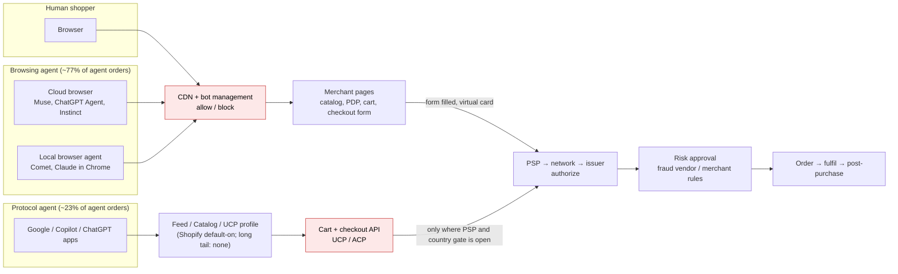
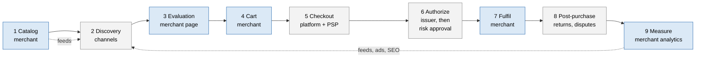

# The e-commerce flow, and what agents change at each step

**Date:** 4 November 2026
**Status:** Background reference, independent of any pivot. Describes how an online sale works with a human shopper and, at each of the nine steps, what changes when the shopper is an AI agent, which problems are new and which are old problems made worse. Numbers are cited by their row in doc 07, Appendix A (for example A#32). Terms are in [GLOSSARY.md](GLOSSARY.md).

---

## The actors

| Actor | Role in a sale | What they control |
|---|---|---|
| **Shopper** | Wants something, finds it, decides, pays, receives, maybe returns | Their intent, their money, their patience |
| **Merchant** | Sells it: owns the catalog, the prices, the stock, the policies, the risk | Everything on their own site; nothing off it |
| **Platform** (Shopify, WooCommerce, Wix, custom) | Runs the merchant's storefront, cart, checkout and admin | The features the merchant can use; the protocols the store speaks |
| **Channels** (Google, Meta, Amazon, TikTok, affiliates) | Put the merchant's products in front of shoppers | Who sees what, and what they charge for it |
| **PSP** (Stripe, PayPal, Isracard/PayMe, Tranzila…) | Takes the payment | Which payment methods and protocols the merchant can accept |
| **Card network and issuer** | Authorize the payment; decide disputes | The rules; the final word on who pays for a bad order |
| **Fraud vendor** (Forter, Signifyd, Radar) | Scores the authorized order before the merchant accepts it | The approve/decline decision, within the merchant's appetite |
| **Carrier, 3PL** | Move the goods | Delivery promise and cost |
| **CDN, bot management** (Cloudflare, Akamai) | Sit in front of the site; serve pages fast; filter automated traffic | Who gets a page at all |

---

## How agents enter the flow

An agent is software acting for a person. It reaches the store in one of two ways: **browsing**, where it drives the merchant's pages as a person would (from a cloud browser or inside the user's own browser), or **protocol**, where it reads a feed and calls cart and checkout APIs and never sees a page. Today browsing is about three quarters of agent orders and nine tenths of agent traffic (A#9, A#11). Agent activity is overwhelmingly steps 2 and 3: about 95% is discovery and lookup, about 2.4% is checkout (A#8). Terms: **discovery** is finding candidates (step 2, off the merchant's site); **lookup** is what step 3's evaluation becomes when an agent does it, checking variant, price, stock and conditions for one item at one merchant; **transactability** is whether it can actually be bought to this address on these terms, which today only a cart and checkout attempt answers.

The summary table at the end collects it.

### The three ways a shopper now reaches the store



Red boxes are the gates the merchant does not hold: bot management decides who gets a page, and the protocol checkout only exists where the PSP and the buyer's country are admitted. Browsing agents walk through the first gate as a shopper and skip the second by filling the form and paying with a virtual card, which is why the merchant usually cannot tell they were there.

---

## The flow at a glance

Shaded steps are the ones the merchant controls. The others are rendered or decided by the platform, the PSP, the card network or the channel.



Plain text, for readers without a diagram renderer:

```
 MERCHANT           CHANNELS          MERCHANT            MERCHANT       PLATFORM + PSP
 ┌──────────┐      ┌───────────┐     ┌────────────┐      ┌────────┐     ┌────────────┐
 │ 1 Catalog│─feed▶│ 2 Discover│────▶│ 3 Evaluate │─────▶│ 4 Cart │────▶│ 5 Checkout │
 └──────────┘      └───────────┘     └────────────┘      └────────┘     └─────┬──────┘
                                                                              │
 ISSUER + FRAUD VENDOR        MERCHANT            NETWORK + MERCHANT     MERCHANT
 ┌────────────────────┐      ┌──────────┐        ┌──────────────────┐   ┌───────────┐
 │ 6 Authorize,       │◀─────┘          │        │ 8 Post-purchase  │   │ 9 Measure │
 │   then approve     │─────▶│ 7 Fulfil │───────▶│   returns,       │──▶│   and     │──┐
 └────────────────────┘      └──────────┘        │   disputes       │   │   retain  │  │
                                                 └──────────────────┘   └───────────┘  │
        ▲                                                                              │
        └──────────────────── ads, SEO, feeds, email back into 2 ──────────────────────┘
```

---

## The nine steps, before and with agents

Each step: what happens, a diagram, what goes wrong before agents, then what agents change, the new challenges they introduce, and the old problem they make worse.

**1. Catalog and merchandising.** The merchant creates products, each with variants (size, colour, pack), prices, stock, images, descriptions, and the attributes a channel will ask for (GTIN, brand, category). The merchant also writes the conditions: shipping zones and rates, delivery promises, returns window, warranty, member pricing. On most platforms products are structured data and conditions are prose on a policy page or settings scattered across the admin.

```
 BRAND / GS1                      MERCHANT'S PRODUCT DATA                         CHANNELS
 ┌──────────────┐                ┌───────────────────────────────────┐          ┌─────────────────┐
 │ GTIN issued  │──on the item──▶│ CATALOG  (per variant)            │          │ Google Merchant │
 │ to the brand │                │   GTIN · brand · category · title │──feed───▶│ Center          │
 └──────────────┘                │   attributes · images · MPN       │          ├─────────────────┤
                                 ├───────────────────────────────────┤──feed───▶│ Meta catalog    │
                                 │ INVENTORY  stock per variant,     │          ├─────────────────┤
                                 │            per location           │──listing▶│ Amazon          │
                                 ├───────────────────────────────────┤          └────────┬────────┘
                                 │ OFFER      price · promo          │                   │
                                 ├───────────────────────────────────┤                   ▼
                                 │ CONDITIONS shipping zones + rates │     channel matches the GTIN to
                                 │  (prose +  delivery promise       │     its own product record and
                                 │  settings) returns · warranty     │     checks brand and category
                                 │            member pricing         │     against it
                                 └───────────────────────────────────┘
                                   in the feed: catalog + stock + price
                                   not in the feed: conditions
```

*Before agents, what goes wrong:* stale stock, wrong variant images, prices that differ between site and feed, shipping rates that don't match what the policy page says. Feed error rates in the low single digits per item are normal.

**When the shopper is an agent: the record is now the product.**

*What the agent needs that a human didn't.* A human reads a product page and fills gaps from pictures, context and common sense. An agent reads structured data: a feed, a JSON-LD block, a UCP or ACP profile, or whatever its browser can parse from the DOM. Anything not in that data does not exist for the agent.

*New challenges agents introduce.*
- **Conditions are not data.** Shipping rates, delivery promises, returns windows, warranty and member pricing live in prose and settings. Every agent protocol flattens them to a store-level sentence or drops them (doc 05 §5). The agent cannot answer "can I get this to Haifa by Thursday and return it if it doesn't fit," so it either guesses or declines.
- **Variants must map across three surfaces.** The feed, the storefront and the checkout each have their own identifiers. About half of failed protocol sessions are variant and ID shape problems (A#23).
- **Freshness has no contract.** No feed or catalog publishes a freshness SLA; Shopify Catalog has a seven-day removal lag. A human tolerates a stale page by checking at checkout; an agent that has already committed the user to a cart does not.
- **The same record must serve two patterns.** The feed serves protocol agents; the page serves browsing agents. Today they are maintained separately, and they drift.

*Old problem made worse.* Catalog error rates that were tolerable for humans become order errors for agents, because the agent acts on the data without the human's sanity check.

---

**2. Discovery.** The shopper searches (Google, Amazon, the site's own search), scrolls (Meta, TikTok), or follows a recommendation. The merchant competes through SEO on its pages, paid ads, product feeds to Google Shopping and Meta, and marketplace listings. Discovery is where most of the merchant's acquisition money goes.

```
                    paid feed + bids         organic crawl            marketplace listing
 SHOPPER ──query──▶ ┌──────────────┐     ┌──────────────────┐      ┌──────────────┐
    │               │ Google       │     │ Google organic   │      │ Amazon       │
    │               │ Shopping ads │     │ results          │      │ search       │
    │               └──────┬───────┘     └────────┬─────────┘      └──────┬───────┘
    │                      │ click ($)            │ click (free)          │ stays on Amazon
    │                      ▼                      ▼                       ▼
    │               MERCHANT SITE (lands on a PDP)                 Amazon PDP
    │
    └──scroll──▶ Meta / TikTok feed ──ad click ($)──▶ MERCHANT SITE  (or in-app shop)

 Merchant puts in:  feed → Merchant Center / Meta · pages → crawler · bids → auction
 Merchant gets back: clicks, cost per click, and (via its pixel) which clicks converted
```

*Before agents, what goes wrong:*
- **Ranking is unpublished and reverse-engineered.** Google does not disclose how it ranks; SEO is twenty years of inference from experiments and leaks, and an algorithm update can halve a store's traffic overnight with no explanation.
- **Reputation decides rank before relevance does.** Domain authority, seller ratings, review count and age, and brand search volume are ranking inputs everywhere. A new or small merchant starts invisible and stays so until it has a footprint it cannot buy directly.
- **Pay to play crowds out organic.** Shopping ads and sponsored listings take the top of the page; organic positions have moved down for years; cost per click rises as more merchants bid for the same queries. The merchant pays for clicks that don't convert.
- **Marketplaces prefer themselves.** Amazon's results favour its own and fulfilled-by-Amazon items and the Buy Box logic decides which seller gets the sale for a shared listing.
- **Attention is concentrated.** The first few results take most clicks; the long tail of merchants is effectively unseen.
- **Feed quality gates visibility.** Disapproved items, missing GTINs, price mismatches between feed and page, and out-of-stock items shown as available cost rank and cost trust; the shopper lands on the wrong variant.
- **The merchant cannot see its own rank.** It sees clicks and impressions for ads, little for organic, and can only infer position by searching itself.

**When the shopper is an agent: the channel is now the agent, and the merchant has no feed to it.**

*What agents change.* Discovery is the step agents have already taken. AI-referred visits went from 2.9% to 5.5% of US retail visits in nine months and convert 1.6 times better (A#1, A#2). The agent decides which merchants to show from what it can read, and increasingly buys inside its own surface without a click-out.

*New challenges agents introduce.*
- **No feed path for the long tail.** Shopify auto-enrolled three million stores into ChatGPT, Copilot, Google and Meta (A#20). WooCommerce, Wix beyond discovery, Squarespace and the rest, 40% of stores, have no equivalent. For them, discovery by agents is page-only.
- **Ranking is unpublished, and what is disclosed favours integration.** No agent publishes how it chooses which stores to show. OpenAI's stated signals for ranking merchants that sell the same product are availability, price, quality, whether the merchant is the maker or primary seller, and whether its checkout integration is enabled ([PPC Land](https://ppc.land/how-chatgpt-product-results-are-selected-displayed-and-ranked), [Baltimore Sun](https://www.baltimoresun.com/2025/09/30/chatbot-shopping)). Google ranks from the Shopping Graph and Merchant Center quality signals; Muse completes 3.5 times more often on Shop Pay partners (A#22). Being wired into the agent's checkout is itself a discovery factor. SEO took twenty years to reverse-engineer; this has had one.
- **Reputation is weighed from sources the merchant does not control.** Agents summarize reviews and sentiment from the public web, Reddit threads, review sites and press, and fold them into the recommendation. A merchant with a thin public footprint is not down-ranked; it is absent. There is no equivalent of buying a first page of ads to be seen.
- **The shelf is short and winner-take-most.** A search page shows ten links and a row of ads; an agent shows three to five options and often one. Two studies disagree on who wins: a Lightspeed-sponsored analysis of about half a million "where should I buy" answers found a national retailer chosen over a smaller one up to 94% of the time ([Lightspeed](https://www.lightspeedhq.com/news/ai-favors-big-retailers-over-local-stores-9-out-of-10-times-new-study-finds/)); a Recomaze test of 58,000 Gemini prompts found recommendations dispersed, with the top brand at 1.3% ([Recomaze](https://recomaze.ai/state-of-AI-commerce-2026-key-findings)). Both are vendor studies and the difference is query framing. What is not in dispute is that no merchant can know its own position.
- **The shelf is different every time.** The same product query produces a different set of stores per assistant and per run ([WARC](https://www.warc.com/article/ai-shopping-assistants-create-radically-different-shelves-for-the-same-product-ba34dbcb0a1b4a168de98c8ad109ef53)). A merchant cannot test its rank reproducibly, and one assistant dominates: ChatGPT produced about 80% of AI product recommendations against Google AI Mode's 20% in one eight-category sample ([Jellyfish via Pulse](https://www.pulse.bot/ecommerce/blogs/20-of-chatgpt-conversations-are-shopping-most-brands-arent-there-062c6a60-1620-4a87-b886-d2f88f208270/)). A store's agent discovery depends on one company's index.
- **Sponsored bias is arriving.** ChatGPT sells ads in 89 countries; Google and Meta run their agents on their ad businesses. A Princeton and University of Washington study found most of 23 models tested favoured pricier sponsored options over the best deal in a booking task ([Pulse](https://www.pulse.bot/retail/blogs/ai-shopping-agents-tend-to-push-pricier-sponsored-options-instead-of-the-best-deal-a-princeton-and-u-129eec48-7b87-4dd2-8de3-efa2868c73a6/)). The merchant pays a new auction with no history and no rank report.
- **The index is not the web.** ChatGPT appears to retrieve from its own product index, built from feeds plus crawl, before falling back to search ([Peec, unverified](https://docs.peec.ai/research/chatgpt-shopping-index-experiments)). A store not in the feed is found through a crawler's copy, which may be stale or absent; llms.txt, the proposed fix, is confirmed read by no major agent.
- **Accidental blocking.** 37 of 51 large retailers block agents, most through bot rules they set years ago for scrapers (A#25). A merchant can be invisible to agents without knowing it.
- **No measurement.** The merchant sees referral clicks and nothing else: no impressions, no position, no share of answers. Section 9 covers the rest.

*Old problem made worse.* Paying for traffic that does not convert, now with a channel whose conversion the merchant cannot see (see step 9).

---

**3. Evaluation.** The shopper reads the product page: details, reviews, Q&A, availability, estimated delivery, returns policy, compares with alternatives, often across tabs. The merchant's page design, content and speed decide whether the shopper stays.

```
 MERCHANT PDP (rendered by the platform theme)                    SHOPPER
 ┌─────────────────────────────────────────────────┐
 │ title · images · price                          │◀── reads, zooms images
 │ variant selector  [size ▾] [colour ▾]           │◀── picks variant → price/stock may change
 │ "in stock" · "arrives Thu–Mon"                  │◀── checks availability and delivery
 │ description · specs · reviews (4.6★, 212) · Q&A │◀── looks for "does it fit / is it compatible"
 │ "free shipping over $75" · Returns ──link──┐    │◀── opens policy page (separate prose page)
 │ [ Add to cart ]                            │    │
 └────────────────────────────────────────────┼────┘
                                              ▼         ◀── opens a second tab: competitor's PDP
                                    POLICY PAGE (prose)      compares, decides, or leaves
                                                                      │
                                                                      └── add to cart ──▶ step 4
```

*Before agents, what goes wrong:* unanswered questions (will it fit, is it compatible, when will it arrive), slow pages, pop-ups, policy information buried.

**When the shopper is an agent: the agent asks questions the page doesn't answer.**

*What agents change.* A human evaluates by reading and inferring. An agent evaluates by querying. It asks: does this fit, does it ship there, what does it cost landed, when does it arrive, can it be returned. Then it compares across merchants in seconds. This is where most agent activity is (A#8).

*New challenges agents introduce.*
- **Conditions again, now as the deciding factor.** If two merchants show the same product and only one exposes "ships to Israel, 14-day returns" as data, the agent recommends that one.
- **Product-level questions.** Fitment, compatibility, safety. Shopify's Knowledge Base covers store facts; nothing covers "is this safe for overnight use" (doc 05 gap 12).
- **Page readability for browsing agents.** Hidden variant selectors, prices rendered by JavaScript, cookie walls, pop-ups and slow pages stall browser agents (doc 05 gap 11). No one has measured which fixes help (A#8, A#41 context).
- **Load and latency.** Agents that scrape re-fetch pages at machine rates. Shopify tightened rate limits for unsigned traffic in May 2026. A long-tail store on shared hosting can be slowed by the agents it wants to serve.

*Old problem made worse.* Unanswered questions. A human might buy anyway; an agent moves to the merchant that answers.

---

**4. Cart.** The shopper adds items, sees a subtotal, maybe a shipping estimate and a promo field. The merchant upsells and cross-sells here. Cart abandonment is typically around 70%.

```
 CART PAGE (platform)
 ┌──────────────────────────────────────────────────────┐
 │ line items    variant · qty · unit price              │◀── add / remove / change qty
 │ promo code    [________] apply ──▶ discount rules     │
 │ subtotal                                              │
 │ shipping      "calculated at checkout" or an estimate │◀── needs a destination it may not have yet
 │ cross-sell    "customers also bought …"               │◀── merchant's upsell logic
 │ [ Checkout ]                                          │──▶ step 5
 └──────────────────────────────────────────────────────┘
        │
        └── ~70% stop here ──▶ abandoned-cart email (only if the merchant has the email)
```

*Before agents, what goes wrong:* surprise shipping costs, promo codes that fail, the shopper leaves to think.

**When the shopper is an agent: the compromise is made by software.**

*What agents change.* With a human, the cart is a running decision. With an agent, the cart is constructed from the user's stated intent, which is non-deterministic language, fitted to what is available. Multi-constraint carts ("under $200, arrives by Friday, blue if possible") are where agents fail most: 30% on constraint-heavy benchmark intents (A#34).

*New challenges agents introduce.*
- **The cart may be wrong before anyone sees it.** The agent chose a variant, a quantity, a substitute. The merchant did not participate and the human has not yet looked.
- **Promo and price drift.** The agent built the cart on a price it read earlier; the price at checkout differs. No freshness signal tells either side.
- **The merchant's upsell disappears.** Cross-sell and bundle logic on the cart page is never seen by a protocol agent and ignored by a browsing one.

*Old problem made worse.* Abandonment becomes invisible: an agent that gives up leaves no abandoned-cart email to send.

---

**5. Checkout.** The shopper gives or confirms identity (guest or account), shipping address, chooses a shipping method, enters payment, sees tax and total, confirms. The platform renders this page; the PSP renders the payment fields; 3DS may challenge the shopper. The merchant can configure little here beyond which methods are on.

```
 CHECKOUT PAGE (form by the platform · payment fields by the PSP)
 ┌───────────────────────────────────────────────────────────────────┐
 │ 1 identity   guest email  |  log in                               │
 │ 2 address    ──▶ shipping-zone check ──▶ "we don't ship there" ✗  │
 │ 3 shipping   method + rate from the merchant's zones ──▶ total    │
 │ 4 payment    card · Shop Pay · PayPal · Apple Pay   ◀── PSP iframe│
 │ 5 tax        computed for the destination                         │
 │ 6 confirm    [ Pay $X ]                                           │
 └───────────────────────────────┬───────────────────────────────────┘
                                 │ card data goes to the PSP, not the merchant
                                 ▼
                3DS challenge? (issuer decides) ──▶ shopper's bank app / SMS code
                                 ▼
                              step 6
 Merchant configures: methods on/off, zones, rates.   Merchant cannot change: the form, the PSP flow.
```

*Before agents, what goes wrong:* form friction, declined cards, 3DS challenges that fail, addresses the merchant doesn't ship to discovered only at the last step.

**When the shopper is an agent: the form is filled by a machine, or skipped entirely.**

*What agents change.* Two cases. A protocol agent calls the checkout API and the merchant's checkout page is never rendered; the agent surface (Google, Copilot, Meta) shows the user a summary. A browsing agent fills the merchant's checkout form itself, with a cloud browser, using a virtual card (A#14).

*New challenges agents introduce.*
- **Identity of the buyer.** The merchant sees an order from a Cloudflare IP with a single-use card number and a name. It cannot tell whether a person approved it (doc 07 §3). Half of agent orders are from an agent that signs nothing a merchant can verify (A#10, A#14).
- **Consent is not recorded.** The protocols define consent artefacts (AP2 Cart Mandate) but no platform stores one for the merchant. If the order is later disputed, the merchant has nothing to show.
- **The gate is upstream.** In-agent checkout exists only for buyers in a few countries and through PSPs that support the protocols (A#27, A#28). A merchant cannot opt in; it can only be admitted.
- **The merchant's checkout rules don't run.** Address validation, shipping-zone checks and quantity limits live on the checkout page. A protocol agent never loads it; a browsing agent may bypass client-side checks.
- **3DS and step-up.** A challenge meant for a human reaches a cloud browser. Either it fails (lost sale) or the agent has the user's device in the loop (new flows, not yet standard).

*Old problem made worse.* Addresses the merchant doesn't serve, discovered at the last step, now discovered after the order (step 7).

---

**6. Payment authorization and risk approval.** The PSP sends the payment to the card network, the issuer says yes or no (authorization). If yes, the fraud vendor or the merchant's own rules decide whether to accept the order (risk approval). Only then is the order confirmed to the shopper.

```
 PSP ──▶ CARD NETWORK ──▶ ISSUER (shopper's bank)
                              │   yes / no  =  AUTHORIZATION   (funds held, not yet taken)
                              ▼
 ┌──────────────────────── RISK APPROVAL ─────────────────────────┐
 │ fraud vendor or merchant rules score the authorized order:     │
 │   IP · device · address mismatch · velocity · email age · past │
 │                                                                │
 │   approve ──▶ order confirmed to shopper ──▶ step 7            │
 │   decline ──▶ authorization voided   (false decline if genuine)│
 │   review  ──▶ a person looks ──▶ approve / decline             │
 └────────────────────────────────────────────────────────────────┘
 Capture (money actually moves) usually happens at shipment, in step 7.
```

*Before agents, what goes wrong:* false declines (good orders refused), fraud accepted, both measured in basis points of sales.

**When the shopper is an agent: the fraud model has never seen this.**

*What agents change.* Authorization works: 98.8 to 100% (A#29). Risk approval did not: fraud vendors' models, trained on humans, declined 56% of scraping-agent orders until Forter loosened rules on 24 September, after which approval rose to 73% (A#30).

*New challenges agents introduce.*
- **Agent orders look like fraud.** Cloud IP, headless browser, single-use card, no session history. Every signal a fraud model uses to catch a bot is present in a legitimate agent order.
- **Loosening the rules opens the door to real fraud.** Once "looks like an agent" means "approve," imitating an agent is the attack.
- **The decision is identity-shaped but identity is unavailable.** The clean fix, verify the agent's signature, works for ChatGPT Agent and Codex and not for Muse (A#16).
- **The merchant's own eligibility rules are not in the loop.** Risk approval asks "is this fraud," not "do I ship there." The second question is where agent orders actually fail (step 7).

*Old problem made worse.* False declines, now concentrated on a fast-growing order type.

---

**7. Fulfilment.** The merchant picks, packs, ships, sends tracking. The order may be cancelled before shipping by the shopper (changed mind) or the merchant (cannot fulfil: out of stock, cannot ship there, price error).

```
 ORDER QUEUE (platform admin or OMS)
    │
    ├── merchant cancels ✗   out of stock · cannot ship to that address · price error · suspected fraud
    ├── shopper cancels  ✗   changed mind, before shipment
    │
    ▼
 PICK ──▶ PACK ──▶ LABEL (carrier rate, tracking no.) ──▶ CARRIER / 3PL ──▶ DELIVERED
    │                                                          │
    └── capture payment ──▶ PSP                                └── tracking emails to shopper

 Oversell  = picked, and it isn't there.      Misship = wrong variant in the box.
```

*Before agents, what goes wrong:* oversells, wrong item shipped, delivery promise missed.

**When the shopper is an agent: the order lands for the wrong place.**

*What agents change.* The one confirmed production failure. Merchant-initiated cancellations run 27% in Asia and the Middle East and 37% in Europe on scraping-agent orders, against about 10% for human orders (A#32). Forter attributes them to agents ordering outside the merchant's eligibility: wrong country, wrong currency, unsupported destination.

*New challenges agents introduce.*
- **Eligibility was never checked.** The human would have seen "we don't ship to your country" on the checkout page. The agent paid and the merchant found out in the order queue.
- **Cancellation costs more than it did.** The merchant refunds, loses the authorization, and the shopper's agent records a failed merchant.
- **Customer cancellations are normal, except where checkout is narrow.** Customer-initiated cancellations are 1 to 2%, like humans, except 10% on Google's single-item checkout (A#31), suggesting the shopper found the order was not what they wanted after the agent placed it.

*Old problem made worse.* Cannot-fulfil cancellations, moved from an edge case to a third of orders in some regions.

---

**8. Post-purchase.** Delivery, use, returns within the window, warranty claims, support. If the shopper disputes the charge with their bank, the merchant faces a chargeback: loses the money, usually the goods, and pays a fee. Disputes arrive 30 to 120 days after the order.

```
 DELIVERED
    │
    ├── keeps it ──▶ later: warranty claim ──▶ brand or merchant, per the terms
    │
    ├── returns inside the window ──▶ RMA ──▶ ships back ──▶ inspected ──▶ refund via PSP
    │                                  (who pays return shipping: per policy)
    │
    └── disputes with the bank ──▶ CHARGEBACK   (30–120 days after the order)
                                     │  issuer pulls the money back + fee
                                     ▼
                       merchant submits evidence: checkout record · tracking · policy shown
                                     ▼
                       network rules decide ──▶ merchant wins (rarely) or loses
 Reasons: item not as described · not received · unauthorized · "friendly fraud"
```

*Before agents, what goes wrong:* returns (20 to 30% in apparel), item-not-as-described disputes, friendly fraud.

**When the shopper is an agent: nobody knows yet.**

*What agents change.* Returns, warranty claims and disputes on agent orders will arrive on the same 30 to 120 day lag as human ones. As of 4 November 2026 no one has published a wrong-item, return or dispute rate for agent orders (A#33). Forter promises to address disputes on 12 November.

*New challenges agents introduce.*
- **Who is liable is settled, and it is the merchant.** Every protocol's terms make the merchant seller of record and leave disputes to it. The agent company is not a party.
- **The evidence does not exist.** For a human order the merchant can show the checkout page the shopper saw. For an agent order there is no stored record of what the agent was shown or what the human approved (doc 05 gap 5).
- **Returns policies were not read.** If the agent did not expose the returns window at evaluation, the shopper may learn it at the return.
- **The error floor is structural.** Our estimate: by 2028–2029 around 2 to 5% of agent orders at a typical small merchant will be materially wrong, set by unclear intent, bad merchant data and humans rubber-stamping confirmations (A#37, A#38). Better models lower the model's share of that, not the rest.

*Old problem made worse.* Item-not-as-described disputes, now with no evidence on the merchant's side.

---

**9. Measurement and retention.** The merchant's analytics attribute the sale to a channel (via pixels and UTM parameters), compute conversion and return on ad spend, and feed email, loyalty and retargeting.

```
 CHANNEL ──UTM-tagged click──▶ MERCHANT SITE ──────────────▶ ORDER
                                     │                         │
                               pixel fires                pixel fires
                               (page view)                (purchase: value, items)
                                     │                         │
                                     ▼                         ▼
                        ANALYTICS (GA, platform reports) ──▶ conversion by channel · ROAS
                                     │                          ▲
                                     │                          │ blind spots: ad blockers,
                                     │                          │ privacy opt-outs, cross-device
                                     ▼
                        RETENTION  email / SMS list · loyalty · retargeting audiences ──▶ back to step 2
```

*Before agents, what goes wrong:* attribution is already approximate; privacy changes have broken pixels; the merchant optimizes on partial data.

**When the shopper is an agent: the merchant cannot see the channel.**

*What agents change.* Agent discovery and checkout happen on surfaces where the merchant's pixels do not fire. Google, Copilot and Meta direct checkout never load the merchant's page. Browsing agents from cloud IPs show up as direct traffic. Shopify's per-channel reports cover its own channels and exclude headless; Wix shows citations only; WooCommerce and BigCommerce show nothing (doc 05 gap 4).

*New challenges agents introduce.*
- **Failed agent checkouts are invisible.** An agent that reached checkout and was blocked or cancelled leaves no trace the merchant can count.
- **Attribution is double-broken.** Pixels already lost accuracy to privacy changes; agents remove them entirely on protocol surfaces.
- **Analytics are polluted.** Agent sessions inflate traffic and deflate conversion unless separated, and the merchant cannot separate them (step 5 identity).
- **No benchmark exists.** A merchant cannot know whether its agent conversion is good, because no one publishes agent conversion by platform or vertical.

*Old problem made worse.* Optimizing on partial data, with a new channel whose data is mostly missing.

---

## What the merchant actually controls

Across the nine steps, the merchant owns the catalog, the conditions, the page, the rules it gives its fraud vendor, the fulfilment, and the returns policy. It does not own discovery (channels), checkout rendering (platform and PSP), authorization (issuer), or disputes (network). This split runs through every step above: agents move work from the parts the merchant owns to the parts it does not.

---

## Summary table

| Step | Merchant controls it today | Human problem | What agents change | New problem (not a worse old one) | Doc 07 layer |
|---|---|---|---|---|---|
| 1 Catalog | Yes | Stale data, feed errors | Record is the product; conditions must be data; two patterns served from one record | Conditions as structured data; cross-surface variant mapping; freshness | Truth |
| 2 Discovery | No (channels) | Unpublished ranking, reputation-gated, pay to play, concentrated attention | Agent is the channel; ranking unpublished and integration-weighted; reputation read from the public web; shelf short, different every run, dominated by one index | Integration as a ranking factor; absence rather than low rank; no feed path for the long tail; accidental blocking; sponsored bias; no rank report | Serve |
| 3 Evaluation / lookup | Yes (the page) | Unanswered questions | Agent queries instead of reading; conditions decide the recommendation | Page readability for machines; rate limits; product-level Q&A | Truth, Serve |
| 4 Cart | Yes | Abandonment | Cart built by software from ambiguous intent | Wrong cart before anyone looks; price drift without signal | Truth, Decide |
| 5 Checkout | No (platform, PSP) | Form friction, declines | Form filled by a machine or skipped; buyer identity unknown | Unverifiable buyer; no consent record; merchant rules bypassed; gate held upstream | Decide, Prove |
| 6 Authorization and approval | Partly (rules) | False declines, fraud | Fraud models decline agents; loosening invites imitation | Identity-shaped decision with identity unavailable; eligibility not in the loop | Decide |
| 7 Fulfilment | Yes | Oversells, misships | Orders land for unserved destinations | 27–37% merchant cancellations ex-US on scraper orders | Decide |
| 8 Post-purchase | Partly | Returns, disputes | Liability unchanged, evidence gone, rates unknown | No stored record of what the agent was shown or the human approved | Prove, Guarantee |
| 9 Measurement | Yes (analytics) | Attribution approximate | Pixels don't fire on agent surfaces | Failed agent checkouts invisible; polluted analytics; no benchmark | Prove and measure |

**Reading the table.** The new problems cluster at steps 1, 3 and 7, which the merchant controls, and at step 5, which it does not. The problems at steps the merchant controls can be fixed by a merchant-side product. The problems at step 5 can only be worked around: serve correctly whatever gets through, and record it. Step 8 is unmeasured and waits for data.
